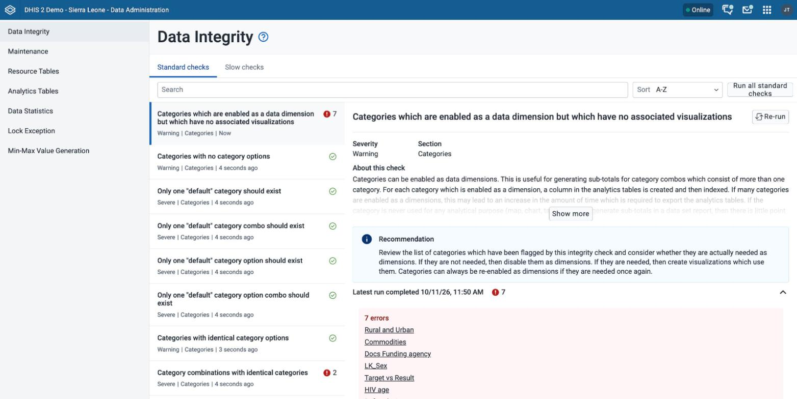
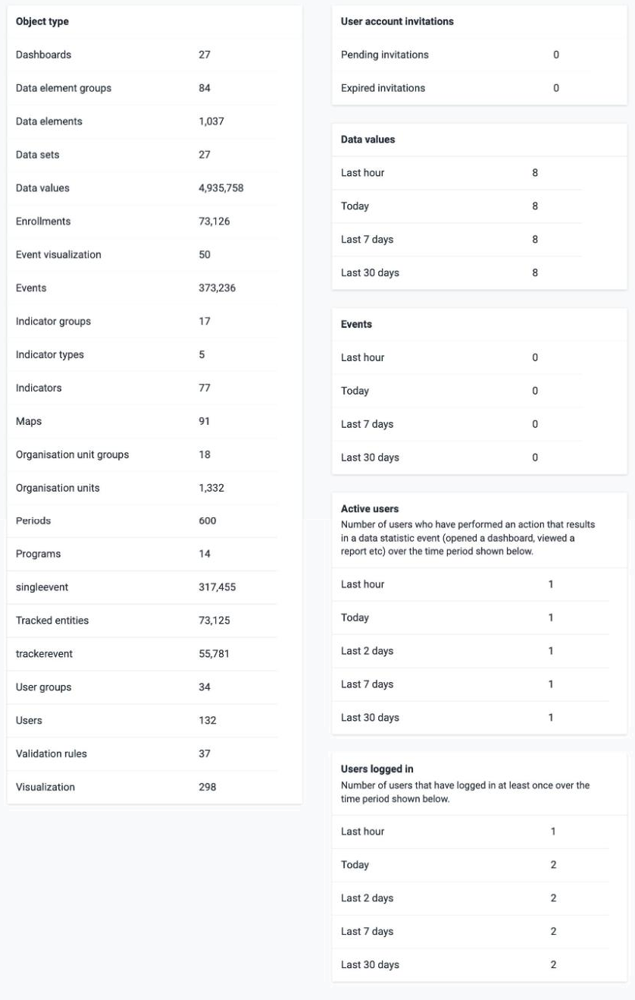
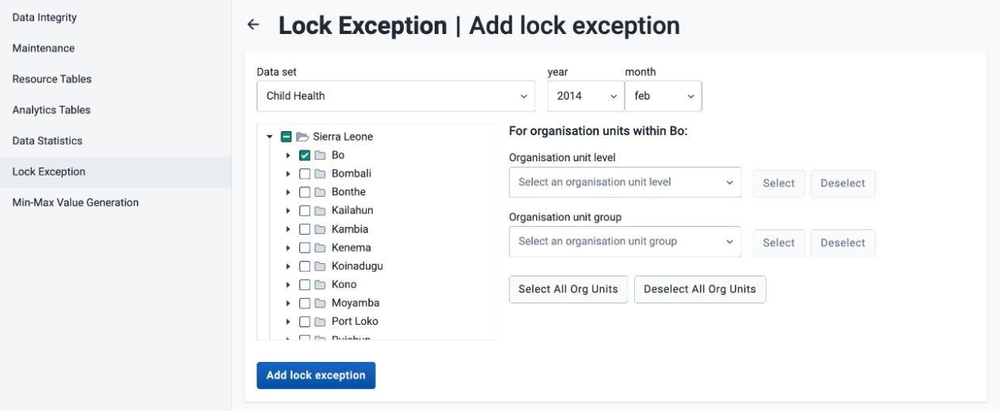
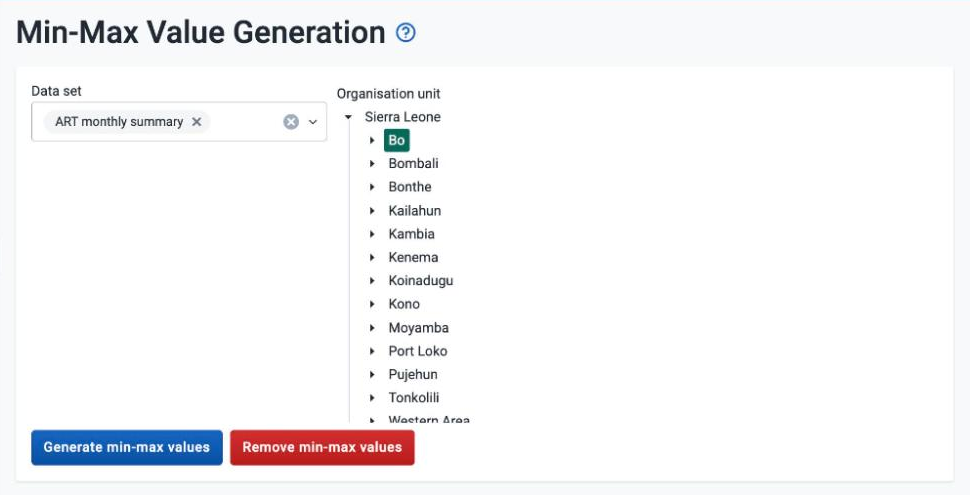

# Data Administration { #data_admin }

This page explains the functions in the **Data Administration** app. The
functions check the integrity of the data in the DHIS2 database and improve
the database performance. A data administrator should run these
functions on a regular basis to keep the quality of the stored data
high.

## Data integrity { #data_admin_data_integrity }

DHIS2 can perform many data integrity checks on the data in the
database. Identifying and correcting data integrity issues is extremely
important, because the data that you use for analysis must be valid.
This section describes some of the data integrity checks that the system
performs, and gives general procedures that resolve these issues.

In the **Data Administration** app, the checks are organized into two
tabs: **Standard checks** and **Slow checks**. Slow checks can take
significant time and resources to complete on large databases, for
example checks that query the `datavalue` table directly. You
must run slow checks individually, not all at once. On the **Standard
checks** tab, click **Run all standard checks** to run every standard
check at once.

Use **Search** to find a check by name. Use **Sort** to order the list by
name (**A-Z**) or by **Number of errors**. Choose a check in the list to see its severity (Info, Warning, Severe or
Critical), its section, a description under **About this check**, a
**Recommendation**, and the result of its latest run. Click **Run** to
run a check that has not run yet. Click **Re-run** to run that one check again.
To run a check, you must have the authority `F_PERFORM_MAINTENANCE`.

Each name in the list of errors is a link that opens the object in a new browser tab. Metadata objects open in the **Metadata Management** app. Dashboards, visualizations, users, user groups, and user roles open in their own apps.

> **Note**
>
> The steps in this section use the **Metadata Management** app. If your instance does not have the **Metadata Management** app, use the **Maintenance** app instead. See [Configure metadata (Metadata Management app)](#metadata_management_app).

The app has more checks than this page describes. The headings in this
section use the names that the app shows. To read the description and
recommendation of any other check, choose it in the app.

#### v40 and earlier { #data_admin_data_integrity_v40_and_earlier }

In v40 and earlier, the **Data Administration** app does not have the **Standard checks** tab or the **Slow checks** tab.

In v40 and earlier, the **Data Administration** app does not have the **Run all standard checks** button.

### Aggregate data elements which are not a member of any dataset

Aggregate data elements should normally be assigned to at least one data
set. If a data element is not assigned to a data set, you cannot enter
values for it in the system. There can be valid reasons to leave a data
element out of all data sets. Otherwise, in the **Metadata Management** app,
choose **Data sets** > **Data sets**, open the appropriate data set, and add the
"orphaned" data element to it.

### Aggregate data elements not in any data element groups

All aggregate data elements should be in at least one data element
group. Groups make data elements easier to find in the analysis apps and
help to complete data element group sets. In the **Metadata Management** app, choose **Data elements** > **Data element groups**
and add each data element that the check lists to a
relevant group. If you do not need the data element, delete it.

### Data elements which belong to multiple groups in a group set

Some data elements have been allocated to several data element groups
that are members of the same data element group set. All group sets in
DHIS2 are defined as exclusive, which means that a data element can
*only* be allocated to *one* data element group within that group set.
In the **Metadata Management** app, choose **Data elements** > **Data element groups**
to review each data element identified in the integrity check.
Either remove the data element from all groups except the one that it
should be allocated to, or decide whether one of the groups should be in
a different group set.

### Data sets with data elements not in data entry form

Data elements have been assigned to a data set, but are neither in the data
entry form of the data set nor in a section of the data set. For all data
sets that use section forms, you should generally assign each data element in
the data set to exactly one section of the data set. Alternatively, remove the
data elements from the data set.

This check is on the **Slow checks** tab.

### Aggregate data elements which belong to data sets with different period types

Data elements should not be assigned to two separate data sets whose
period types differ. The recommended approach is to create two
separate data elements (for example, a monthly and a yearly data element)
and assign these to the respective data sets.

### Data sets which have not been assigned to any organisation units

All data sets should be assigned to at least one organisation unit.

### Indicators with identical formulas

Although this rule does not affect data quality, it generally does not
make sense to have two indicators with the exact same definition. Review
the identified indicators and their formulas, and delete or modify any
indicator that appears to be a duplicate.

### Indicators not included in any groups

All indicators should be assigned to at least one indicator group,
so you should allocate these indicators to their correct indicator
group. In the **Metadata Management** app, choose **Indicators and Predictors** >
**Indicator groups**, and allocate each of the \`Orphaned\` indicators
to its correct group.

### Indicators with invalid numerator

An incorrect reference to a deleted or modified data element can cause
violations of this rule. Review the indicator and correct the
numerator definition.

This check is on the **Slow checks** tab.

### Indicators with invalid denominator

An incorrect reference to a deleted or modified data element can cause
violations of this rule. Review the indicator and correct the
denominator definition.

This check is on the **Slow checks** tab.

### Indicators which belong to multiple groups in a group set

Some indicators have been allocated to several indicator groups that are
members of the same indicator group set. All group sets in DHIS2 are
defined as exclusive, which means that an indicator can *only* be
allocated to *one* indicator group within that group set. In the
**Metadata Management** app, choose **Indicators and Predictors** > **Indicator groups** to
review each indicator identified in the integrity check. Either remove
the indicator from all groups except the one that it should be allocated
to, or see if one of the groups should be placed in a different group
set.

### Periods with the same start date and period type

Periods that have the same start date and period type are duplicates.
If periods have been imported from external applications, some periods
might be duplicated. If any periods appear to be duplicated here, you
must resolve these directly in the DHIS2 database. You should move all
data that has been assigned to a duplicated period to the period with the
lower period ID, and remove the duplicate period.

### Organisation units with cyclic references

Organisation units cannot be both parent and children of each other,
directly or indirectly. If this situation occurs, you must
resolve the cyclic reference directly in the DHIS2 database, in the
`organisationunit` table, by reassigning the `parentid` field of the
organisation units.

This check is on the **Slow checks** tab.

### Orphaned organisation units

Orphaned organisation units have neither a parent nor any children, so they
have no relationship to the main organisation unit hierarchy. All organisation
units must exist within the organisation unit hierarchy. In the **Metadata Management** app, choose **Organisation units** > **Hierarchy operations** and move the
offending organisation unit into the proper position in the hierarchy.

### Organisation units without groups

All organisation units should usually belong to at least one organisation
unit group. Organisation units that do not belong to any group are harder to
identify in analysis apps such as the **Data Visualizer**. Create organisation
unit groups that help you filter classes of organisation units, and add the
organisation units that the check lists to them. In the **Metadata Management** app, choose **Organisation units** >
**Organisation unit groups** to review each organisation unit identified and add the
relevant group allocation.

### Orgunits that are not in all compulsory orgunit group sets

These organisation units have not been assigned to any organisation
unit group within one of the *compulsory* organisation unit group sets.
When a group set is defined as compulsory, it means that an organisation
unit must be allocated to at least one organisation unit group within
that group set. For instance, all organisation units must belong to one
of the groups in the 'Type' group set. An organisation unit might belong to the
\`Hospital\` group, the \`Clinic\` group, or any other 'type' group, but it must
belong to exactly one of them. In the **Metadata Management** app, choose **Organisation units** > **Organisation
unit groups** to review each organisation unit identified in the integrity
check. Allocate all organisation units to exactly one compulsory group.

### Organisation units which belong to multiple groups in a group set

Some organisation units have been allocated to several organisation unit
groups that are members of the same organisation unit group set. All
group sets in DHIS2 are defined as exclusive, which means that an
organisation unit can *only* be allocated to *one* organisation unit
group within that group set. For instance, an organisation unit cannot
normally belong to both the 'Hospital' and 'Clinic' groups, but
only to one of them. In the **Metadata Management** app, choose **Organisation units** > **Organisation
unit groups** to review each organisation unit identified in the integrity
check. Remove each organisation unit from all groups except the one that
it should be allocated to.

### Validation rules without a validation rule group

All validation rules should be assigned to a group. In the **Metadata Management** app, choose **Validations** > **Validation rule groups** and assign the offending validation
rule to a group.

### Validation rules with invalid left side expression

The left-side validation rule definition has an error. In the **Metadata Management** app, choose **Validations** > **Validation rules**, edit the
offending rule, and correct the **Left side expression**.

This check is on the **Slow checks** tab.

### Validation rules with invalid right side expression

The right-side validation rule definition has an error. In the **Metadata Management** app, choose **Validations** > **Validation rules**, edit the
offending rule, and correct the **Right side expression**.

This check is on the **Slow checks** tab.

### Program rules without rule conditions

The report highlights all **Program rules** that do not have a **Condition**. Rules without a condition always evaluate as false.

### Program rules without priorities

The report highlights all **Program rules** that do not have a **Priority**. Priority is optional, but it is very important when `ProgramRuleActionType` is `ASSIGN`. Rules with the `ASSIGN` action type should have higher priority than the rest of the action types.

### Program rules without actions

The report highlights all **Program rules** that do not have any `ProgramRuleAction`.

### Program rule variables lacking a data element

The report highlights all **Program rule variables** that do not have a `DataElement`. The report is based on the source type configuration. You should provide a `DataElement` when the source type of `ProgramRuleVariable` is `DataElement`.

This check is on the **Slow checks** tab.

### Program rule variables lacking an attribute

The report highlights all **Program rule variables** that do not have a `TrackedEntityAttribute`. The report is based on the source type configuration. You should provide a `TrackedEntityAttribute` when the source type of `ProgramRuleVariable` is **Attribute**.

This check is on the **Slow checks** tab.

### Program rules with actions lacking a data object

The report highlights all **Program rule actions** that do not have any data object. A data object can be either a `DataElement` or a `TrackedEntityAttribute`. Some ProgramRuleActions assign values to either a dataElement or a trackedEntityAttribute.

This check is on the **Slow checks** tab.

### Program rule with actions lacking a notification template

The report highlights all **Program rule actions** that have `ProgramRuleActionType` set to `SENDMESSAGE/SCHEDULEMESSAGE` where the configuration does not provide any link to a notification.

This check is on the **Slow checks** tab.

### Program rules with actions lacking a program stage section

The report highlights all **Program rule actions** that have `ProgramRuleActionType` set to `HIDESECTION` but the configuration does not provide any section id.

This check is on the **Slow checks** tab.

### Program rules with actions lacking a program stage

The report highlights all **Program rule actions** that have `ProgramRuleActionType` set to `HIDEPROGRAMSTAGE` but the configuration does not provide any program stage id.

This check is on the **Slow checks** tab.

### Program indicators with invalid expression

The report lists all violations in the program indicator expression that are caused by an invalid `DataElement` or an invalid `TrackedEntityAttribute`.

This check is on the **Slow checks** tab.

### Program indicators with invalid filter

The report lists all violations in the program indicator filter expression that are caused by an invalid `DataElement` or an invalid `TrackedEntityAttribute`.

This check is on the **Slow checks** tab.

### Tracked entity attributes having a suboptimal search configuration that potentially results in slower search performance when searching tracked entities using those attributes

The report lists all tracked entity attributes with a suboptimal configuration. This configuration can result in slower search performance when you search for tracked entities using those attributes.

### Partial trigram indexes on trackedentityattributevalue table must be in sync with the tracked entity attribute metadata configuration

The report lists all tracked entity attributes that are not in sync with the trigram index in the database. This means that some indexes might need to be created, deleted, or both.

### Tracked entity attributes that have a partial trigram index created on the trackedentityattributevalue table

The report lists all tracked entity attributes that have a partial trigram index in the `trackedentityattributevalue` table.

#### v42 and earlier { #data_admin_data_integrity_v42_and_earlier }

In v42 and earlier, the links in the list of errors open metadata objects in the **Maintenance** app, even when the **Metadata Management** app is installed.

In v42 and earlier, the **Data Administration** app does not have the check **Tracked entity attributes having a suboptimal search configuration that potentially results in slower search performance when searching tracked entities using those attributes**.

In v42 and earlier, the **Data Administration** app does not have the check **Partial trigram indexes on trackedentityattributevalue table must be in sync with the tracked entity attribute metadata configuration**.

In v42 and earlier, the **Data Administration** app does not have the check **Tracked entity attributes that have a partial trigram index created on the trackedentityattributevalue table**.

## Maintenance { #data_admin_maintenance }

To run maintenance functions, open the **Data Administration** app and click **Maintenance**. Choose the functions that you want and click **Perform maintenance**. To run these functions, you must have the authority `F_PERFORM_MAINTENANCE`.

Table: Data maintenance functions in the Data Administration app

| Function | Description |
|---|---|
| Clear analytics tables | Deletes the analytics tables from the database. These tables are used to generate aggregate data for the pivot tables, GIS, and reports. |
| Analyze analytics tables | Performs a PostgreSQL `analyze` operation on all analytics tables. |
| Remove zero data values | Removes zero data values from the database. DHIS2 removes a zero value only if its data element has the aggregation operator sum and does not have **Zero is significant** chosen. DHIS2 keeps zero values for data elements with other aggregation operators, such as average, because such values are significant when you aggregate the data.   Reducing the number of data values improves system performance. |
| Permanently remove soft deleted data values / events / enrollments / tracked entity instances | When you delete a data value in DHIS2, the system marks the corresponding database row as deleted and does not actually delete the row.   Running this maintenance function physically removes these data value rows from the database. |
| Prune periods | Removes all periods that are not in use. A period is in use when a data value, a data set completion, an approval, a data input period, a lock exception, a validation result, or a saved visualization, map, event report, or interpretation refers to it. Reducing the number of periods improves system performance. |
| Remove expired invitations | Deletes users that represent user account invitations that are past their expiry date. |
| Drop SQL views | DHIS2 lets you create and manage SQL views as system objects with corresponding database SQL views.   Running this maintenance function drops the underlying SQL views for all system views. Use the **Create SQL views** function to recreate these SQL views. |
| Create SQL views | Recreates all SQL views in the database. |
| Update category option combinations | Rebuilds the category option combinations. This might be required after you change the category options that belong to a given category. |
| Update organisation unit paths | The `organisationunit` table in the DHIS2 database has a column `path` that contains a concatenated string of all ancestors in the hierarchy for each organisation unit.   Running this maintenance function updates these values and makes sure that they are in sync with the current organisation unit hierarchy. DHIS2 manages this column, but a manual update might be useful when you load data directly in the database.   In 2.43.2 and later, this function does nothing. |
| Clear application cache | Clears the server caches: the Hibernate cache and the analytics partition caches. It does not clear the cache in your web browser. If you modify the database directly, clear the application cache for the change to take effect. |
| Reload apps | Manually reloads and detects installed DHIS2 apps.   DHIS2 also detects the installed apps when the system starts and when you install or uninstall apps. |

#### 2.43.2 and later { #data_admin_maintenance_2_43_2_and_later }

In 2.43.2 and later, the **Update organisation unit paths** function in the **Data Administration** app does nothing.

In 2.43.2 and later, DHIS2 stores the organisation unit path as an array of UIDs.

## Resource tables { #data_admin_resource_tables }

Resource tables are supporting tables that you use when you analyze
data. You typically join the contents of these tables with the
data value table when you query from third-party applications like
Microsoft Excel. The analysis modules of DHIS2 also use them extensively.
You should regenerate the resource tables only after
all data integrity issues are resolved. The system also
generates the resource tables automatically every time it runs the
analytics process.

To generate the resource tables, open the **Data Administration** app, click **Resource Tables**, and click **Generate tables**. To run this function, you must have the authority `F_PERFORM_MAINTENANCE`.

  - **Organisation unit structure** (`analytics_rs_orgunitstructure`)

    You should regenerate this table any time the organisation unit
    hierarchy changes. This table
    provides information about the organisation unit hierarchy. It has
    one row for each organisation unit, one column for each organisation
    unit level and the organisation unit identifiers for all parents in
    the lineage as values.

  - **Data element group set structure** (`analytics_rs_dataelementgroupsetstructure`)

    This table provides information about which data elements are
    members of which data element group sets. The table has one row for
    each data element, one column for each data element group set and
    the names of the data element group as values.

  - **Indicator group set structure** (`analytics_rs_indicatorgroupsetstructure`)

    This table provides information about which indicators are members
    of which indicator group sets. The table has one row for each
    indicator, one column for each indicator group set and the names of
    the indicator group as values.

  - **Organisation unit group set structure**
    (`analytics_rs_organisationunitgroupsetstructure`)

    This table provides information about which organisation units are
    members of which organisation unit group sets. The table has one row
    for each organisation unit, one column for each organisation unit
    group set and the names of the organisation unit groups as values.

  - **Category structure** (`analytics_rs_categorystructure`)

    This table provides information about which data elements are
    members of which categories. The table has one row for each data
    element, one column for each category and the names of the category
    options as values.

  - **Data element category option combo name** (`analytics_rs_categoryoptioncomboname`)

    You should regenerate this table any time the category combination
    names change. It contains readable names
    for the various combinations of categories.

  - **Data element structure** (`analytics_rs_dataelementstructure`)

    This table provides information about all data elements and which
    period type (frequency) they capture data at. The period type is
    determined through the data set membership, so it relies on data
    elements being members of data sets with similar period types to have
    a defined behavior.

  - **Date period structure** (`analytics_rs_dateperiodstructure`)

    This table provides information about all periods and which period
    type they are associated with. For each period type with lower
    frequency than itself, it contains information about which period it
    falls within.

  - **Period structure** (`analytics_rs_periodstructure`)

    Similar to `analytics_rs_dateperiodstructure`, containing a scoped set of
    periods more adapted for aggregated analytics.
    It is based on `period` and `periodtype` tables.

  - **Data element category option combinations**
    (`analytics_rs_dataelementcategoryoptioncombo`)

    This table provides a mapping between data elements and all possible
    category option combinations.

  - **Data set organisation unit category** (`analytics_rs_datasetorganisationunitcategory`)

    This table provides information related to data sets, organisation units
    and their associated category option combinations. If no association is found,
    it uses the default category option combo.
  

#### v40 and earlier { #data_admin_resource_tables_v40_and_earlier }

In v40 and earlier, resource table names do not start with `analytics_rs_`.

In v40 and earlier, the name of each resource table begins with an underscore, for example `_orgunitstructure` instead of `analytics_rs_orgunitstructure`.

In v40 and earlier, the other resource tables follow the same pattern: `_dataelementgroupsetstructure`, `_indicatorgroupsetstructure`, `_organisationunitgroupsetstructure`, `_categorystructure`, `_categoryoptioncomboname`, `_dataelementstructure`, `_dateperiodstructure`, `_periodstructure`, `_dataelementcategoryoptioncombo` and `_datasetorganisationunitcategory`.

## Analytics tables management { #data_admin_analytics_tables }

DHIS2 generates database tables that the system then uses as a basis for
various analytics functions. These tables are also valuable if you write
advanced SQL reports. In the **Data Administration** app, you can start the table
generation immediately. To schedule the generation at regular intervals,
use the **Scheduler** app. This lets you refresh recent analytics on
demand and see updated pivot tables without waiting for all of the data from past years to
re-process.

> **Note**
>
> You can also generate the tables through the web API. A system
> administrator typically performs this task.

To generate the analytics tables, you must have the authority `F_PERFORM_MAINTENANCE`.

1.  Open the **Data Administration** app and click **Analytics Tables**.

2.  Choose the parts of the analytics process that you want to skip:

      - **Skip generation of aggregate data and completeness data**

      - **Skip generation of resource tables**

      - **Skip generation of event data**

      - **Skip generation of enrollment data**

      - **Skip generation of organisation unit ownership data**

      - **Skip generation of tracked entity data** (checked by default)

      - **Skip generation of outlier data** (checked by default)

3.  Choose **Number of last years of data to include**. The default is **All**. If you choose 0,
then you run latest or continuous analytics, as defined in
[Continuous analytics table](scheduler-app.html#scheduling_continuous_analytics_table).
A value of 3 includes the current year and the two years before it.

4.  Click **Start export**.

> **Important**
>
> When you include only the last years, the app rebuilds those years and leaves the older years as they were. After a change that adds or removes an analytics dimension, for example turning **Data dimension** on or off for a category or a group set, the older years no longer match the rebuilt years. Queries that cover both can then show no data, or fail with error code E7145 (**Query failed because of a syntax error**). After such a change, run the analytics tables update once for all years, with **Number of last years of data to include** set to **All**. Later runs can include only the last years again.

If an analytics request fails with the message **Query failed because a referenced table does not exist. Please ensure analytics job was run** (error code E7144), a table that the request needs is missing. For example, the analytics tables have not been generated, or that part was skipped when they were generated. Generate the tables as described in this section.

#### v40 and earlier { #data_admin_analytics_tables_v40_and_earlier }

In v40 and earlier, the **Data Administration** app does not have the option **Skip generation of tracked entity data**.

In v40 and earlier, the **Data Administration** app does not have the option **Skip generation of outlier data**.

## Data statistics { #data_admin__data_statistics }

The data statistics module provides an overview of the number of objects
stored in the DHIS2 database.

The app shows the total number of each type of object in the **Object type**
table. Other tables show the number of pending and expired user account
invitations. They also show the number of data values and events registered in recent time
periods, and the number of active users and users who logged in.

The **Active users** table shows the number of users who have performed an action that results in a data statistic event, for example opening a dashboard or viewing a report. The **Users logged in** table shows the number of users who have logged in at least once. A user who logs in more than once in a time period counts once. Both tables show the last hour, today, the last 2 days, the last 7 days and the last 30 days.

To open this page, you must have the authority `F_PERFORM_MAINTENANCE`.

#### v42 and earlier { #data_admin_data_statistics_v42_and_earlier }

In v42 and earlier, the **Data Administration** app (version 100.1.8 and later) shows one table of users, **Users logged in**.

In v42 and earlier, the **Data Administration** app (version 100.1.8 and later) does not show the **Active users** table.

#### v43 and later { #data_admin_data_statistics_v43_and_later }

In v43 and later, the **Data Administration** app shows the **Active users** table and the **Users logged in** table.

## Lock exceptions { #data_admin__lock_exception }

Lock exceptions provide fine-grained control over exemption from a
locked data set.

This section covers lock exceptions on aggregate data sets only. Tracker programs have
their own expiry settings, and data approval locks data separately. Neither is set here. After the expiry of the data set, DHIS2 denies data entry
by default, unless an exception has been granted through the **Lock
Exception** interface.

### Adding a lock exception

A lock exception enables data entry even after the
expiry period of the data set has passed.

1. Open the **Data Administration** app and click **Lock Exception**.
2. Click **Add lock exception** at the top of the page.
3. Choose the data set, the period, and the organisation units that
   you want (see the following screenshot). The period menus depend on the
   period type of the data set. For a monthly data set, you choose a year and a month. The organisation unit tree is limited to the organisation units that are assigned to the data set and the organisation units above them in the hierarchy. You can use the organisation unit
   level and organisation unit group lists, with the **Select** and **Deselect** buttons, or the **Select All Org Units**
   button, to choose several organisation units at once.
4. Click **Add lock exception**.

In the previous example, DHIS2 creates a data lock exception for "Bo" for the
"Child Health" data set for "February 2014".

At least one of the organisation units that you choose must be assigned to the
data set. Otherwise, the app shows an error that none of the target
organisation units is linked to the data set.

To add a lock exception, you must have the authority `F_DATASET_PUBLIC_ADD` and access to edit the data set. Each organisation unit that you choose must be one of your data capture organisation units, unless you have the authority `ALL`. If you do not have the required access, the request fails with the message **You don't have the proper permissions to update this object**.

### Deleting a lock exception

1. Open the **Data Administration** app and click **Lock Exception**.
2. In the list, find the lock exception for the organisation unit, data set
   and period you want to remove, and click **Remove lock exception** (trash can icon).
3. Click **Yes, remove lock exception** to confirm, or **No, cancel** to
   keep it.

This removes the lock exception for that single organisation unit only.

To remove a lock exception, you must have the authority `F_DATASET_DELETE` and access to edit the data set. The authorities `F_PERFORM_MAINTENANCE` and `F_DATASET_PUBLIC_ADD` do not give you this access. If you do not have it, the request fails with the message **You don't have the proper permissions to delete this object.** You do not need the authority `ALL`. A user who needs to add and remove lock exceptions needs both `F_DATASET_PUBLIC_ADD` and `F_DATASET_DELETE`.

### Batch deletion

A data set and period combination can have lock exceptions across many
organisation units, for example 100 organisation units. In this case, you can
remove all of them in one action instead of one at a time.

1. Open the **Data Administration** app and click **Lock Exception**.
2. Click **Batch deletion** at the top of the page.
3. Find the data set and period combination that you want in the list, and click
   **Batch delete lock exceptions** (trash can icon).
4. Click **Yes, remove lock exception** to confirm.

This removes the lock exception for that data set and period across *all*
organisation units it applies to, not just one.

## Min-Max Value Generation { #data_admin_min_max_value_generation }

Use this administrative function to generate min-max values,
which DHIS2 uses as part of the data quality and validation process for
specific organisation units and data sets. Choose one or more data sets in
the **Data set** menu, and then choose an
organisation unit in the **Organisation unit** tree. Click
**Generate min-max values** to generate or regenerate the min-max values
for the data sets and organisation unit that you chose. Click **Remove
min-max values** to remove the min-max values that are stored for them.
To run this function, you must have the authority
`F_GENERATE_MIN_MAX_VALUES`.

To set min-max values for a single data value, use the **Data Entry** app. See [Minimum and maximum limits](#aggregate_data_entry_app.limits).

